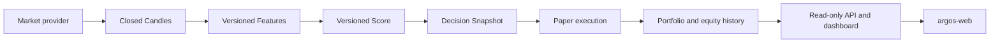

# Architecture Overview

Argos is a private, asset-agnostic quantitative research and predictive decision-support platform. The backend is a domain-oriented modular monolith: modules share one codebase and PostgreSQL database while keeping provider access, analytics, decisions, Paper Trading, and read APIs separated. The Angular SPA lives in the separate `EduBeghe/argos-web` repository.

## Runtime data flow

Every persisted identity includes asset, provider, market type, interval, and time where applicable. Provider-specific Binance tuple semantics stop at the ingestion normalizer; domain, persistence, Features, Scores, Strategies, Decisions, and Paper Trading do not access Binance directly.

## Deployed processes

- `argos-api` serves FastAPI read endpoints. It starts through `scripts/start_api.sh`, applies migrations, and then runs one Uvicorn worker on the platform-provided port. GET requests do not run periodic jobs.
- `argos-ingest` runs `python -m app.jobs.ingest_closed_candles` every five minutes. It requests only fully closed Binance Spot candles, commits candles first, then calculates bounded live Features and Scores in separate transactions. It never generates Decisions.
- `argos-decide` runs `python -m app.jobs.generate_market_decisions` at UTC minutes 02 and 32. It evaluates the latest eligible persisted evidence for the :00 or :30 boundary, persists Decision Cycles and Decision Snapshots, executes Paper Trades, and persists one equity snapshot after all configured instruments succeed.
- PostgreSQL stores immutable evidence, operational Paper state, and optimization memory.
- `argos-web` is a separately deployed static Angular SPA served by Caddy. It consumes public API contracts and is data-driven by `/market/instruments`.

These are separate processes built from the same backend repository, not microservices with independent domain implementations.

## Transaction and failure boundaries

Candle ingestion, Feature calculation, and Score calculation commit independently. Consequently, a Feature or Score failure does not erase successfully ingested candles. A later ingest retries missing analytics inside the recent ingestion time window even when candle inserts are duplicates. Feature calculation loads at most 1,000 context candles per instrument, so live memory use does not grow with the historical candle table.

Decision processing uses one transaction per instrument. A failure for one instrument does not roll back a successfully committed cycle for another. PostgreSQL uniqueness and `ON CONFLICT` protect idempotency; retries return or skip existing immutable results rather than repeat financial effects. The equity snapshot is written only after all configured instrument cycles complete for the boundary.

The API owns request-scoped database sessions and is read-only at the current public surface. Administrative Paper reset is a CLI operation, not an implicit API mutation.

## Responsibility boundaries

- Ingestion knows provider transport and normalization. It does not decide trades.
- Features measure candle evidence. Scores aggregate it without changing source values.
- Strategy converts a compatible Score into requested intent. A bullish label alone is not an instruction.
- Paper execution applies versioned simulated fees and adverse slippage. It never contacts an exchange or moves real money.
- Optimization reads reproducible historical evidence in memory, optionally persists compact experiment results, and never activates a candidate.
- The frontend presents evidence; it does not recompute authoritative financial values.

See [Current system reference](010-current-system.md), [API contract](011-api-and-frontend-contract.md), and the [Railway runbook](012-railway-operations.md).
